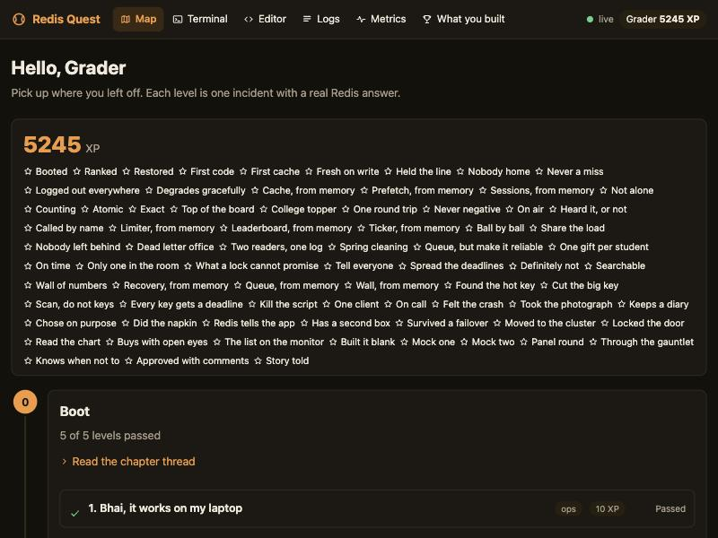
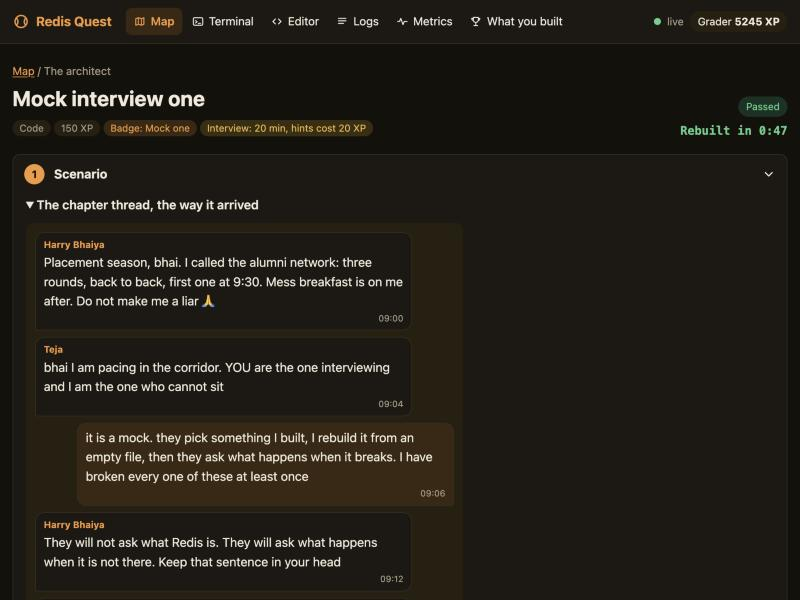
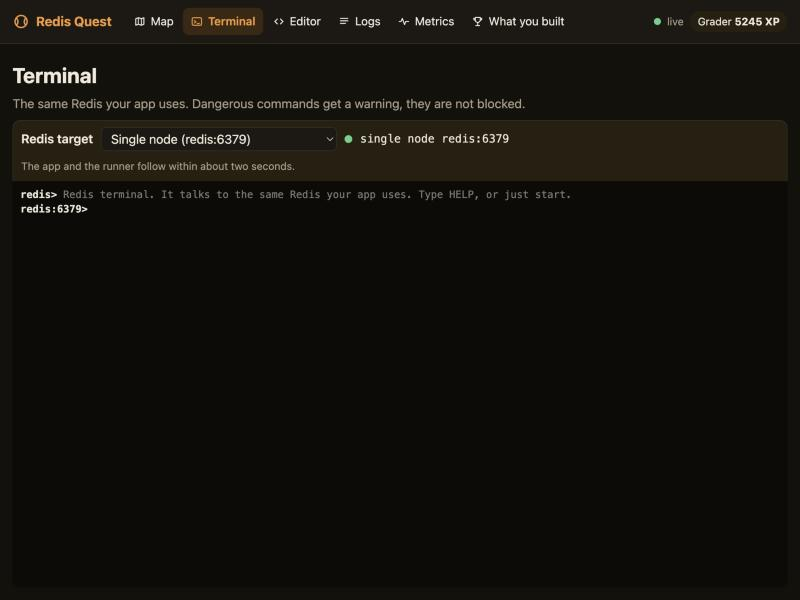
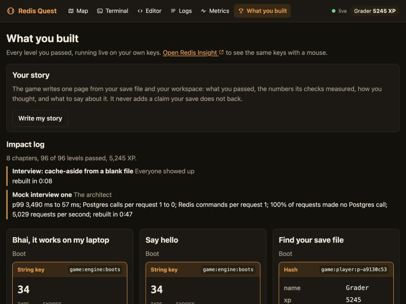
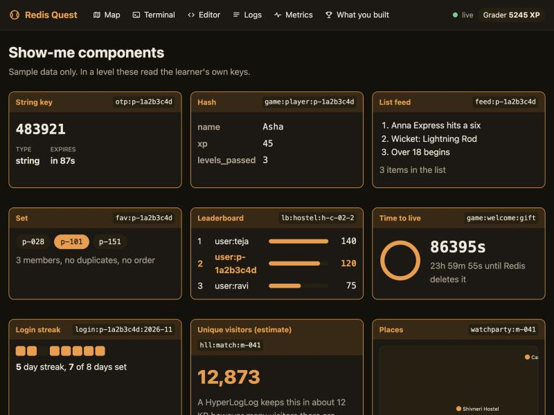

# Redis Quest

Redis Quest is a story-driven game that takes a backend engineer with basic JavaScript from "never seen
Redis" to "can design, build, operate and defend a Redis system in an interview". You play the backend
engineer of a fantasy cricket app that a hostel roommate and you built in a weekend, and the app goes very
wrong in the best way, one chapter at a time. Everything runs on your own Mac: every level makes you do
something real against a real Redis, a real Postgres and real traffic, and tells you honestly what broke and
what you fixed.



## What is inside

- **8 chapters, 96 levels**, from `docker compose up` to a Sentinel failover and a cluster migration, each
  level a scenario, a brainstorm, a short lesson, a build, a verdict and the reference answer.
- **Nine real use cases, each met three times**: a guided build inside the story (cache-aside, prefetch
  cache, session store, rate limiter, leaderboard, pub/sub ticker, streams with consumer groups, job queue,
  time-series dashboard), a timed rebuild from a blank file later in the chapter, and a mock interview at the
  end where the game draws the use case for you and the interviewer asks what happens when it breaks.
- **A real backend to break and fix**: a Fastify app with a seeded Postgres (20,000 users, 200,000 contest
  entries, a deliberately slow stats query), a load generator that fires real traffic at it, and your code
  loaded into named slots of that app while it serves.
- **Scale and failure on a laptop**: two app instances behind one proxy, a Redis you stop on purpose, a Lua
  script that freezes the server, a client leak you watch climb, a node without persistence that loses the
  over, a replica, three Sentinels and a six-node cluster.
- **Six on-call scenarios** where the code is already written and already wrong: name the fault from the
  server's own numbers before you may fix it.
- **Honest grading.** Every level is graded against a real Redis: your function runs on a sandboxed runner
  with fixtures, under concurrency when the lesson is a race, and under load against a baseline the game
  recorded itself. "Works, but wrong" is a verdict of its own.
- **Something to keep**: your `workspace/` is a working fantasy-cricket backend on Redis, and the game writes
  a one-page portfolio from your save with the numbers its checks measured.

## Who it is for

A backend developer (or a student about to become one) who writes JavaScript, has heard of Redis and has
never run it under load. You do not need to know any Redis. If you can read an HTTP route and a SQL query,
you can play. The game is in English with a little Hinglish, and the story is set in an Indian college fest.

Windows and Intel Macs are not supported in this version. Linux is not supported either.

## The story

You and Sai Teja ("Teja"), your roommate who does the frontend and screenshots every error before reading it,
built a fantasy cricket app for the Nukkad Cricket League, a fictional eight-franchise league. Harry Bhaiya,
the final-year senior who runs the college fest, announced it in every mess hall, so it has users before it
has a cache. Warden Sir's nephew Bunty found a way to claim the welcome gift twice. TextTara Sir, the SMS
vendor, sends polite invoices for OTPs you did not mean to send. Mukul and the Gomti Gang from the rival
college run scripts against your API because it is more fun than their own app. Every chapter opens with the
chat thread as it arrived, and every level is one thing that went wrong that night.

All names, colleges and the league are fictional.

## What you need

- A Mac with Apple Silicon (M1 or newer) and at least 16 GB of RAM
- Docker Desktop for Mac (the Apple Silicon build), with 8 GB of memory assigned to it
  (Settings, Resources, Memory)
- Git (the Xcode Command Line Tools provide it)
- About 10 GB of free disk space; the preflight checks for it, and the images take about 2 GB

No Node, no Homebrew, no Redis install.

## Start

```bash
git clone https://github.com/PUNEETRKRAJPUT/Redis-Quest.git
cd Redis-Quest
./scripts/start
```

Then open http://localhost:3000. The first start downloads images and builds the game, so give it a few
minutes. `scripts/start` runs `scripts/preflight.sh` first and tells you in plain words what is missing.
Redis Insight (the window where you can see your keys) is at http://localhost:5540.

## The eight chapters

There are 96 levels. Each chapter opens with a chat thread that is the incident.

| Chapter | Title                  | Levels | The incident                                                                       | What you build                                                                                                                                                         |
| ------- | ---------------------- | ------ | ---------------------------------------------------------------------------------- | ---------------------------------------------------------------------------------------------------------------------------------------------------------------------- |
| 0       | Boot                   | 5      | "bhai the app is not opening on my laptop. it works on yours?"                     | Bring the stack up, find your own save file in Redis, survive the roommate who ran `docker compose down`                                                               |
| 1       | The keyspace           | 16     | Registration opens at 9 tonight for all four hostels                               | Profiles, wallet points, team picks, favourite players, a first scoreboard, a login streak, a visitor count, a stadium map; then your first code, registering a user   |
| 2       | Everyone showed up     | 13     | Toss at 7:30, the stats page is a four-second spinner, a hundred people refreshing | A cache for the player stats page, fixtures kept fresh from the legacy database, OTP login sessions; then three timed interviews                                       |
| 3       | Compete and talk       | 15     | The leaderboard takes three seconds, the SMS invoice arrives, a second app copy    | A rate limiter that works across app copies, live leaderboards, a wallet that cannot go negative, the live ticker; then three timed interviews                         |
| 4       | Work in the background | 19     | Last over of the chase, forty thousand teams need points per ball, a ball skipped  | A ball-by-ball stream with workers that recover, a job queue, a lock for the last contest slot, username and contest lookups, an ops wall; then three timed interviews |
| 4b      | On call                | 7      | The pager goes off at 2 am during the semi-final                                   | Diagnose first, fix second: six planted faults and an on-call checklist                                                                                                |
| 5       | Survive and scale      | 14     | Teja restarted Redis "to fix a warning"; the leaderboard is gone                   | Persistence that fits, a replica, automatic failover, a cluster, locking the door, a production checklist                                                              |
| Finale  | The architect          | 7      | Placement season: three rounds, back to back                                       | Three mock interviews drawn for you, a decision gauntlet, a code review, and your story                                                                                |

The level counts above are the number of level files in each chapter's directory under `levels/`.
Chapter 5 uses extra containers (a no-persistence node, a replica, Sentinel, a cluster). The levels tell
you which `docker compose --profile ... up -d` command to run and when; nothing extra starts by default.

## How a level works

Every level has the same seven stages, and you only touch the Redis part.

1. **Scenario**: the chat thread, what just happened and who is shouting.
2. **What already exists**: what is built and running, so you do not rebuild it.
3. **Brainstorm**: before any teaching, you pick an approach and write one line. Nothing is graded; the point
   is to commit to a guess. The game shows it back to you after.
4. **Teach**: the concept, the commands and a link to the official docs.
5. **Build**: run commands in the terminal, fill in one file, run a command on your Mac, or make a decision.
   Hints open one at a time.
6. **Verify**: the game checks your work and gives one of three verdicts:
   - **Right**: it works, and the "show me" panel shows it running on your own keys.
   - **Works, but wrong**: it passes today, and the game shows you how it fails under load.
   - **Wrong**: a check failed, and the message says which one and the most likely cause.
7. **The ideal way**: the reference answer, side by side with yours. It opens after you pass, after three
   failed attempts, or when you ask for it.

Levels give XP and some give badges. **Interview levels** are different: a countdown clock, no teaching
page, a blank file, and a hint costs XP (the screen tells you the price before you spend it). The chapter
interviews (the last three levels of Chapters 2, 3 and 4) do not move your earlier file, so copy it to a safe
name first if you want to keep it. In the Finale the game draws the use case for you, moves your earlier file
aside as `<file>.before-<level>` (next to it) and gives you an empty one. After your code passes, the interviewer asks
follow-up questions.



## How your work is graded

Nothing is graded by reading your code. Each level declares checks, and the game runs them against the real
stack:

- **Behavior**: your function is called on a sandboxed runner with the level's fixtures in place, with
  the arguments the task names, and the game reads the keys afterwards. When the lesson is a race, the same
  call runs a hundred or two hundred times at once.
- **Traffic**: a load scenario (so many connections, so many seconds, these routes, this skew of users)
  runs against the app with your code loaded into its slot, and the result is judged against a baseline the
  game recorded itself with your code off: p99 latency, Postgres calls per request, Redis commands per
  request, hit ratio, error rate.
- **Redis checks**: the game reads keys, `INFO`, `CONFIG GET`, `XINFO`, `ACL LIST` and friends with read-only
  commands and compares.
- **Antipatterns**: a check that describes the healthy state; when everything else passes and this one fails,
  the verdict is "works, but wrong", with the sentence about how it fails at the IPL final.
- **Events**: did Redis go away and come back, did the app scale to two instances, did a Sentinel fail over,
  did a message arrive on a channel, did the terminal get `BUSY` and did you `SCRIPT KILL` it.
- **Quizzes and typed answers**: for the decisions, with a model answer that reasons.

Every level ships with a reference solution and at least one wrong one, each declaring the verdict it must
get. A grading harness plays all of them through the engine the way a learner would, including the ops
levels by their own shell scripts on an isolated copy of the stack; the current build grades 315 declared
solutions with no mismatch. The same harness is how a new level earns its place.

## The tools

- **Terminal**: in the page, talks to the Redis on your machine.
- **Editor**: for the levels where you write code; you can also use your own editor on the same files.
- **Run my code in the app**: a switch in the Build stage of code levels. Off, the app runs its own slow
  baseline; on, the app runs your file.
- **Run traffic**: a button on levels that have a load scenario; it sends real traffic at the app for a few
  seconds so you can watch what your change does.
- **Target switcher**: in the terminal header. It points the game at the single node, the no-persistence node,
  the replica, Sentinel or the cluster, or at a Redis URL of your own. The app and the runner follow within
  about two seconds. Chapter 5 uses it.
- **Redis Insight**: http://localhost:5540, already connected to the game's Redis.
- **Logs and Metrics**: two pages in the sidebar. Logs shows what your code and the services print; Metrics
  shows latency and request numbers from the app.
- **What you built**: a page with every level you passed, each with its show-me running on your keys, and an
  impact log with the numbers the checks measured (p99 before and after, calls per request, rebuild times).
- **Write my story**: a button on that page that writes `workspace/PORTFOLIO.md`, a one-page account of what
  you built, with numbers the game measured.





Nineteen show-me panels know how to draw what you built: strings, hashes, lists, sets, sorted sets,
TTLs, bitmaps, HyperLogLogs, geo indexes, streams and their consumer groups, JSON documents, cache
statistics, the stats route's latency, a rate-limit bucket, a time series, a Bloom filter, a Search index and
the ACL users.



## Under the hood

Everything is Docker Compose on your Mac; nothing is hosted and nothing phones home.

| Service    | What it is                                                                                                                                 |
| ---------- | ------------------------------------------------------------------------------------------------------------------------------------------ |
| `proxy`    | Caddy on port 3000. `/app/*` is balanced per request across however many app instances exist; everything else goes to the engine.          |
| `engine`   | The game: levels, your save file, the terminal, the verifier, the load generator (autocannon), the show-me reads, the portfolio. One copy. |
| `app`      | The fantasy-cricket backend (Fastify, node-redis v5, pg). Your files are loaded into named slots while it serves. Scales to two or more.   |
| `runner`   | Runs your function in a fresh Node child per job, with a time limit and a kill, so a loop that never ends cannot take the app down.        |
| `redis`    | `redis:8` with persistence on; JSON, Search, TimeSeries and the probabilistic types are built in. Chapter 5 adds the profiles.             |
| `postgres` | `postgres:16`, seeded with the league: users, teams, matches, balls, fantasy teams, contests, entries, wallets, and an outbox for changes. |
| `insight`  | Redis Insight, provisioned to the game's Redis.                                                                                            |

Your code gets `{ redis, db, log }`: a counted, fail-fast node-redis client (two seconds, then an error you
can catch), a Postgres query function, and a logger that lands in the Logs page. The same contract holds on
the runner and inside the app, on a single node, behind Sentinel or on the cluster.

## Where your work lives

- `workspace/`: your code, one JavaScript file per level at `workspace/<chapter>/<file>.js`. See
  [workspace/README.md](workspace/README.md) for the three rules. The scripts never touch it.
- `.progress/progress.json`: your save file (name, brainstorm lines, attempts, XP, verdicts). The game also
  mirrors it into Redis under `game:*`.
- `<file>.before-<level>` next to the original in `workspace/`: the backups the Finale's mock interviews make
  of your earlier files.
- `workspace/PORTFOLIO.md`: your story, once you write it.
- `logs/`: what the services wrote.

## Stop, reset and start over

- `scripts/stop`: stops everything. Your Redis and Postgres data, your progress and your files are kept.
- `scripts/start`: starts it again.
- `scripts/reset`: asks first, then deletes the Redis, Postgres and Redis Insight data volumes. It keeps
  `.progress/` and `workspace/`.
- For a truly clean slate, run `scripts/reset` and then delete the `.progress/` folder. Your code in
  `workspace/` stays; empty a file to start its level blank.

## Troubleshooting

Run `scripts/preflight.sh` first. It checks the CPU, macOS 14 or newer, Docker, memory, disk, Git and every
port below, and says how to fix what it finds.

| Port                | What uses it        | If something else holds it                                |
| ------------------- | ------------------- | --------------------------------------------------------- |
| 3000                | the game            | set `PROXY_PORT` in `.env`                                |
| 5540                | Redis Insight       | set `INSIGHT_PORT` in `.env`                              |
| 6379                | Redis               | `brew services stop redis`, or set `REDIS_PORT` in `.env` |
| 5432                | Postgres            | stop your local Postgres, or set `PG_PORT` in `.env`      |
| 6380                | Chapter 5 replica   | stop what holds it; this port is fixed                    |
| 26379, 26380, 26381 | Chapter 5 Sentinels | stop what holds them; fixed                               |
| 7100 to 7105        | Chapter 5 cluster   | stop what holds them; fixed                               |

Every port is bound to 127.0.0.1, so nothing is reachable from your network.

- **A port is in use**: copy `.env.example` to `.env`, change the number, run `scripts/start` again.
- **Docker memory**: Docker Desktop, Settings, Resources, Memory: 8 GB, then Apply and restart. The
  preflight fails below 6 GB.
- **Disk under 10 GB**: empty the Trash; `docker system prune -a` removes unused images.
- **The first start loads a 60 MB seed into Postgres**: give it a minute before you open the game.
- **Docker is not running**: `open -a Docker`, wait until the whale stops animating, then try again.

## Status

Release candidate (`v1.0.0-rc2`): every planned chapter is built and every level is machine-graded. A
five-person playtest is the next step; findings go through the issue template. If you are one of the
testers, start with [docs/TESTING.md](docs/TESTING.md).

## Contributing and how it was built

The game was built in small tasks, each with a written spec, one acceptance check in `scripts/check/` and a
handoff note, then committed by one orchestrating session: forty tasks, each check re-run by the
orchestrator before its commit, with the whole set runnable as one local check run whose evidence line is
appended to [docs/ci-local.log](docs/ci-local.log). The task board is [docs/BUILD.md](docs/BUILD.md), the full
design is [docs/PLAN.md](docs/PLAN.md), the story's names and tone are in [docs/fiction.md](docs/fiction.md),
and how levels are graded is in [docs/grading.md](docs/grading.md). Every Redis fact in a level traces to the
official docs through [docs/redis-docs-digest.md](docs/redis-docs-digest.md); measurements made on this stack
are labelled as such. To add or change a level, read [levels/README.md](levels/README.md) and keep
`pnpm --filter @quest/shared levels:validate levels` clean. If you are a playtester, start with
[docs/TESTING.md](docs/TESTING.md).

## Licence

MIT for the game. Redis 8 is tri-licensed RSALv2 / SSPLv1 / AGPLv3 and Redis Insight is SSPL; both are
pulled as Docker images and run only on your machine. Starting the stack accepts Redis Insight's terms
on your behalf so you never see a first-run dialog; analytics and notifications are left off.
